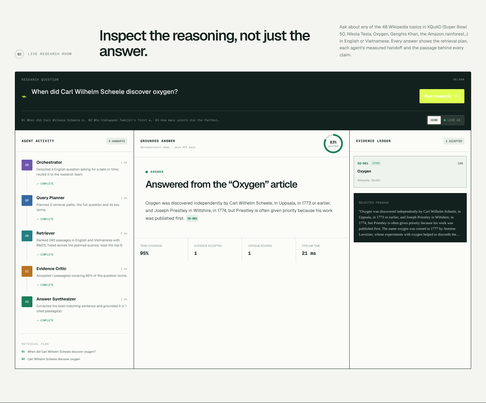
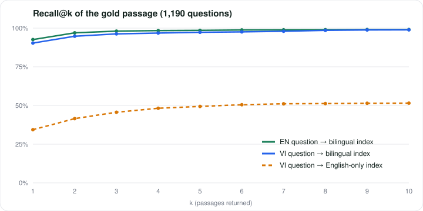
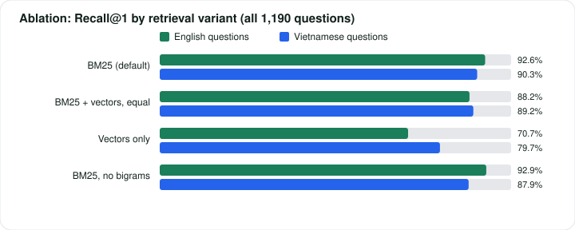
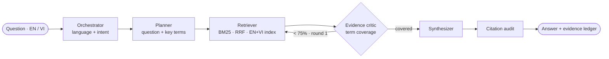
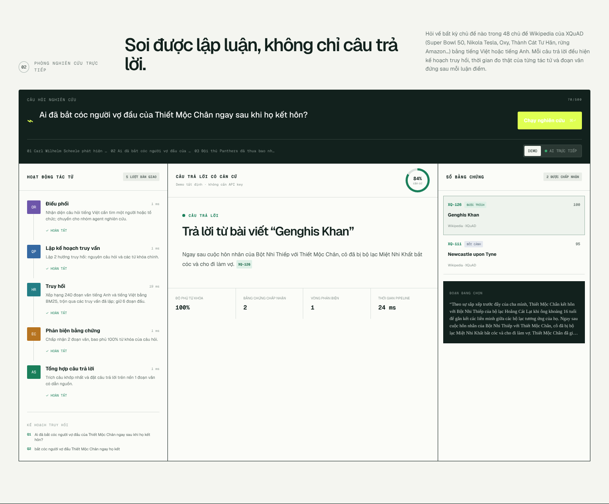
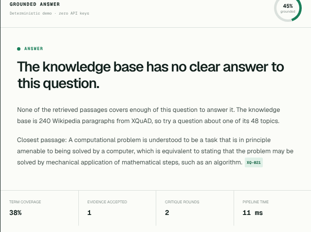
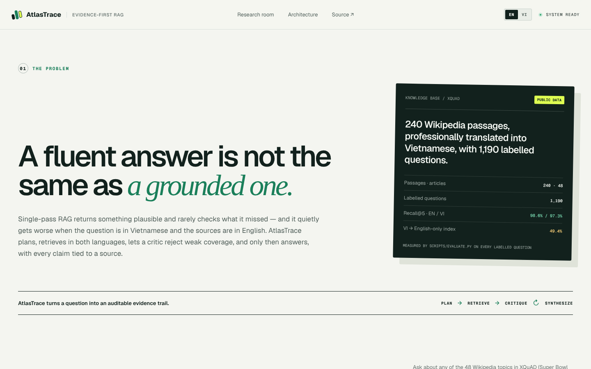

<div align="center">

# AtlasTrace

### Bilingual agentic RAG that shows its work

Ask in **English or Vietnamese**. A LangGraph team of agents plans, retrieves, lets a critic check coverage, and answers with **audited citations** — over a real public dataset, with every number measured.

[](https://github.com/nguyenddung/atlastrace-agentic-rag/actions/workflows/ci.yml)


[](LICENSE)

**[Live demo](https://atlastrace-rag.vercel.app)** · [Results](#results) · [Evaluation](#evaluation) · [Architecture](#architecture) · [Run locally](#run-locally) · 🇻🇳 [Tiếng Việt](README.vi.md)

<br>



</div>

---

## ✨ At a glance

| | |
| --- | --- |
| 🌏 **Bilingual by index** | Every passage is indexed in English *and* Vietnamese. A Vietnamese question hits Vietnamese text directly: **Recall@5 97.3%**, versus **49.4%** against an English-only index. |
| 🔁 **A critic, not a single pass** | The critic measures how much of the question the evidence covers and can trigger a targeted second retrieval, then re-grades the merged evidence. |
| 🔒 **Audited citations** | Any `[ID]` in the answer that is not in the evidence ledger is removed and counted. |
| 🙅 **Says "not found"** | When no passage covers the question, it says so and shows the closest passage instead of guessing. |
| 📏 **Measured, not canned** | Agent latencies are timed, critique rounds are the ones that ran, and the README numbers come from `scripts/evaluate.py` on 1,190 labelled questions. |
| 🛟 **Works without keys** | Demo mode is fully deterministic. Live mode uses a hosted model via Vercel AI Gateway and falls back to Demo on any failure. |

---

<a id="results"></a>

## 📊 Results

On all **1,190 labelled XQuAD questions**, per language.

<table>
<tr>
<td width="50%" valign="top">

**Retrieval** (gold passage)

| | Recall@1 | Recall@5 | MRR@10 |
| --- | --- | --- | --- |
| 🇬🇧 EN → bilingual index | **92.6%** | **98.6%** | 0.953 |
| 🇻🇳 VI → bilingual index | **90.3%** | **97.3%** | 0.935 |
| 🇻🇳 VI → English-only index | 34.4% | 49.4% | 0.405 |

</td>
<td width="50%" valign="top">

**Full pipeline** (Demo mode)

| | 🇬🇧 EN | 🇻🇳 VI |
| --- | --- | --- |
| Gold passage cited first | **92.5%** | **90.3%** |
| Gold passage in ledger | 96.7% | 96.4% |
| Answer in extracted sentence | 73.9% | 72.9% |
| p50 latency | ~7 ms | ~9 ms |

</td>
</tr>
</table>

<p align="center">
  
</p>

---

<a id="evaluation"></a>

## 🧪 Evaluation

`python scripts/evaluate.py --write` runs every labelled question through the index and the full pipeline and writes [`eval/REPORT.md`](eval/REPORT.md), [`eval/report.json`](eval/report.json) and the charts. The Demo pipeline is deterministic, so the numbers reproduce exactly (latency aside). CI runs a 200-question smoke version on every push.

### What is measured

| Metric | Definition |
| --- | --- |
| **Recall@k / MRR@10** | Is the gold passage in the index's top *k* for the raw question; mean of 1/rank |
| **Gold passage cited first** | After plan → retrieve → critique, the gold passage leads the evidence ledger |
| **Answer in extracted sentence** | The gold answer span appears in the sentence the synthesizer chose (sentence-level, not exact span) |
| **Corrective loop rate** | Share of questions where the critic asked for a second retrieval |
| **Not-found rate** | Share flagged unanswerable. Every XQuAD question is answerable, so this is a false-negative rate (EN 3.1%, VI 0.1%) |

### Ablations: what each component is worth

<p align="center">
  
</p>

| Variant | 🇬🇧 Recall@1 | 🇻🇳 Recall@1 |
| --- | --- | --- |
| **BM25 with RRF across planned queries** (default) | **92.6%** | **90.3%** |
| BM25 + feature-hashed vectors, equal RRF weight | 88.2% | 89.2% |
| Feature-hashed vectors only | 70.7% | 79.7% |
| Default without syllable bigrams | 92.9% | 87.9% |

**Three findings that shaped the design**

1. **The vector component was given weight 0.** The fusion weight was chosen on a dev split (first 24 articles) and checked on the held-out 24: weight 0 gives Recall@1 **91.0% EN / 88.2% VI** on the held-out half, versus 87.5% / 87.5% with equal weights. Feature-hashed vectors are a bag of hashed terms, so they add collisions and no information BM25 lacks. The slot stays in the interface for learned multilingual embeddings.
2. **Syllable bigrams matter for Vietnamese only.** They add 2.4 points of Recall@1 for Vietnamese (multi-syllable words like *đội thủ*, *bắt cóc*) and are neutral for English.
3. **An "entities" query was removed from the planner.** Weighted equally in RRF, it over-weighted capitalised words and cut Vietnamese pipeline Recall@1 from 90% to 80%.

### Honest limits

- **The corrective loop rarely changes the answer on XQuAD.** On the 417 EN / 58 VI questions where it fired, the cited passage was the same before and after: the gold passage is almost always in the first six already, and low coverage mostly reflects paraphrase. It costs a few milliseconds and is there for corpora where evidence is spread out, and for Live mode, where a model decides what is missing.
- **Misses are mostly neighbouring paragraphs** of the same article (see the error analysis in the report). A cross-encoder reranker is the next step.
- **Demo answers are extractive** (one sentence). Live mode writes a full answer.

<details>
<summary><b>Accuracy by question type</b></summary>

<br>

| Intent | 🇬🇧 n | 🇬🇧 cited first | 🇬🇧 answer hit | 🇻🇳 n | 🇻🇳 cited first | 🇻🇳 answer hit |
| --- | --- | --- | --- | --- | --- | --- |
| person | 146 | 95.2% | 69.2% | 138 | 92.0% | 66.7% |
| time | 131 | 90.1% | 77.1% | 117 | 89.7% | 76.1% |
| quantity | 105 | 95.2% | 83.8% | 156 | 92.9% | 73.7% |
| place | 45 | 93.3% | 77.8% | 32 | 96.9% | 68.8% |
| reason | 15 | 100.0% | 60.0% | 15 | 100.0% | 60.0% |
| fact | 748 | 91.8% | 73.0% | 732 | 89.1% | 73.8% |

</details>

---

<a id="architecture"></a>

## 🏗️ Architecture



The whole pipeline is a LangGraph `StateGraph` in [`atlastrace/graph.py`](atlastrace/graph.py). Demo and Live run the same graph; only the agents differ.

| Node | Demo mode (deterministic) | Live mode (AI Gateway) |
| --- | --- | --- |
| **Orchestrator** | Detects language and intent (who / when / how many / where / why / fact) | same |
| **Planner** | The full question plus its key terms | 2–4 model-planned queries |
| **Retriever** | BM25 over 480 documents (240 passages × 2 languages), RRF across queries, collapsed onto passage ids | same |
| **Evidence critic** | IDF-weighted term coverage per passage; accepts passages clearing a rank and a coverage bar; requests a corrective retrieval below 75% | Model critic names a missing perspective |
| **Synthesizer** | Best sentence in the question's language, shown in the reader's language via sentence alignment | Model answer, Pydantic-validated |
| **Citation audit** | Strips citations outside the ledger and counts them | same |

<details>
<summary><b>More screenshots</b></summary>

<br>

| Vietnamese question, Vietnamese interface | Out-of-corpus question |
| --- | --- |
|  |  |



</details>

---

## 📚 Dataset

[**XQuAD**](https://github.com/google-deepmind/xquad) (Google DeepMind): 240 Wikipedia paragraphs from SQuAD v1.1 with 1,190 question/answer pairs, professionally translated into Vietnamese and aligned paragraph-for-paragraph. 48 topics, from Super Bowl 50 and Nikola Tesla to the Yuan dynasty and the Amazon rainforest.

`scripts/fetch_xquad.py` downloads and converts it into [`data/xquad/`](data/xquad/README.md). Data license: CC BY-SA 4.0.

---

<a id="run-locally"></a>

## 🚀 Run locally

```bash
git clone https://github.com/nguyenddung/atlastrace-agentic-rag.git
cd atlastrace-agentic-rag

python -m venv .venv && . .venv/bin/activate
pip install -r requirements-dev.txt
npm install

npm run dev:api   # FastAPI on :8000
npm run dev       # Next.js on :3000 (proxies /api/* to :8000)
```

Open <http://localhost:3000>. **Demo mode needs no environment variables.** For Live AI, copy `.env.example` to `.env.local` and set `AI_GATEWAY_API_KEY`.

| Command | What it does |
| --- | --- |
| `pytest` | 20 tests: retrieval quality, citation audit, corrective loop, fallback, a stubbed live run, API |
| `python scripts/evaluate.py --write` | Full evaluation → `eval/REPORT.md`, `eval/report.json`, charts |
| `python scripts/build_initial_results.py` | Re-computes the result shown before the first question |
| `python scripts/fetch_xquad.py` | Re-downloads and converts XQuAD |
| `npm run verify` | Web typecheck → lint → build |

### API

```http
POST /api/research
Content-Type: application/json

{ "question": "Ai đã bắt cóc người vợ đầu của Thiết Mộc Chân?", "mode": "demo", "locale": "vi" }
```

Returns the verdict, answer, confidence, planned queries, evidence ledger, per-agent trace and metrics (`queryCoverage`, `critiqueRounds`, `citationsRemoved`, …) in the requested locale. Rate-limited to 20 requests/min per client (`429` + `Retry-After`). Interactive docs at `/api/docs`.

<details>
<summary><b>Project layout</b></summary>

```text
atlastrace/                 Python package
  text.py                   EN/VI normalisation: deaccenting, stop words, syllable bigrams
  corpus.py                 Loads passages and labelled questions
  retrieval.py              BM25 + vector index, weighted RRF, language collapse
  agents/deterministic.py   Demo planner, critic, synthesizer
  agents/llm.py             Live agents through AI Gateway
  graph.py                  LangGraph pipeline, citation audit, result assembly
  api.py                    FastAPI: POST /api/research, GET /api/health
api/index.py                Vercel Python function entrypoint
scripts/                    fetch_xquad · evaluate · build_initial_results
eval/                       Generated report, JSON and charts
tests/                      pytest suite
app/ components/ lib/       Next.js research room
```

</details>

---

## ☁️ Deploy to Vercel

The Next.js app and the Python function deploy together: `vercel.json` routes `/api/*` to `api/index.py` and bundles `atlastrace/` and `data/xquad/` with it, and Vercel installs `requirements.txt`. For Live AI, enable AI Gateway on the project; deployments authenticate via OIDC, so no key needs to be stored.

## 🛣️ Next steps

- Multilingual embeddings in the vector slot, re-tuned on the dev split
- A cross-encoder reranker for the neighbouring-paragraph misses
- An MCP server exposing `search_evidence`, so other agents can use the index
- Streaming the agent trace in Live mode

## 📝 Summary

> Built and deployed a bilingual (EN/VI) agentic RAG system in Python with LangGraph and FastAPI over the public XQuAD dataset: a bilingual BM25 index with reciprocal rank fusion, a coverage-measuring critic with a corrective retrieval loop, citation auditing and a deterministic fallback for the live model path. Evaluated on 1,190 labelled questions with a dev/held-out split for tuning: Recall@5 98.6% (EN) and 97.3% (VI), versus 49.4% for Vietnamese against an English-only index.

## License

Code: [MIT](LICENSE) · Data in `data/xquad/`: [CC BY-SA 4.0](https://creativecommons.org/licenses/by-sa/4.0/legalcode)
