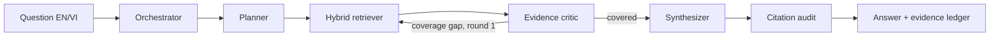

# AtlasTrace — Bilingual Agentic RAG

🇻🇳 [Đọc bằng tiếng Việt](README.vi.md)

An evidence-first agentic RAG system that answers questions in **English and Vietnamese** over a real public dataset, and shows its work: the retrieval plan, every agent handoff with its measured latency, the critic's coverage check, and the passage behind every claim. The agent pipeline is **Python (LangGraph + FastAPI)**; the research room UI is Next.js.

[](https://github.com/nguyenddung/atlastrace-agentic-rag/actions/workflows/ci.yml)
[](https://www.python.org)
[](https://langchain-ai.github.io/langgraph/)
[](https://fastapi.tiangolo.com)
[](https://nextjs.org)
[](LICENSE)

**[Live demo](https://atlastrace-ten.vercel.app)** · [Results](#results) · [Architecture](#architecture) · [Dataset](#dataset) · [Run locally](#run-locally) · [Deploy](#deploy-to-vercel)

> The live demo runs in Demo mode: no API key, no quota. Ask about any of XQuAD's 48 Wikipedia topics (Super Bowl 50, Nikola Tesla, Oxygen, Genghis Khan, the Amazon rainforest…) in English or Vietnamese.

---

## The problem

Single-pass RAG retrieves a few chunks and writes something plausible. It rarely checks whether the evidence actually covers the question, it can cite passages it never retrieved, and it quietly gets worse when the question is in Vietnamese and the sources are in English.

AtlasTrace makes each of those failure modes visible and measurable:

- A **critic** measures how much of the question the evidence covers, and triggers a targeted second retrieval when it falls short.
- Every citation in the answer is **audited** against the evidence ledger; anything outside it is stripped and counted.
- Retrieval is **bilingual by index**, so a Vietnamese question is as well served as an English one.
- When the knowledge base does not contain the answer, the system **says so** instead of guessing.

## Results

Measured by `python scripts/evaluate.py` on all **1,190 labelled XQuAD questions** (full report: [`eval/REPORT.md`](eval/REPORT.md)).

| Retrieval | Recall@1 | Recall@5 | MRR@10 |
| --- | --- | --- | --- |
| English question → bilingual index | 88.2% | 97.7% | 0.922 |
| Vietnamese question → bilingual index | 89.2% | 97.0% | 0.925 |
| Vietnamese question → English-only index (baseline) | 28.2% | 47.8% | 0.359 |

| End to end (Demo mode) | Gold passage cited first | Answer in extracted sentence | Corrective loop | p50 latency |
| --- | --- | --- | --- | --- |
| English | 91.3% | 73.0% | 37.6% | ~9 ms |
| Vietnamese | 85.8% | 69.1% | 6.9% | ~11 ms |

The bilingual index roughly doubles Vietnamese Recall@5 over an English-only index. *Answer in extracted sentence* is sentence-level: the gold answer span appears in the sentence the deterministic synthesizer chose.

## Architecture

A LangGraph state machine in `atlastrace/graph.py`. Both modes run the same graph; only the agent implementations differ.



| Node | What it does |
| --- | --- |
| **Orchestrator** | Detects the question's language and intent (person, time, quantity, place, reason, fact) |
| **Planner** | Demo: the full question, its key terms, and its named entities. Live: 2–4 model-planned queries |
| **Hybrid retriever** | BM25 + IDF-weighted hashed vectors over 480 documents (240 passages × 2 languages), fused with reciprocal rank fusion and collapsed onto passage ids |
| **Evidence critic** | Measures IDF-weighted term coverage per passage and overall; accepts passages that clear both a rank and a coverage bar; below 75% coverage it requests a corrective retrieval for the missing terms, then **re-grades the merged evidence** |
| **Synthesizer** | Demo: picks the best sentence in the question's language and shows its aligned translation in the reader's language. Live: a model answer validated by Pydantic |
| **Citation audit** | Removes any `[ID]` that is not in the evidence ledger and reports how many were removed |

### Two execution modes

| Mode | How it runs | Why it exists |
| --- | --- | --- |
| **Demo** (default) | Deterministic planner, critic and extractive synthesizer. No network, no keys | Anyone can open the live URL and get a real, reproducible answer |
| **Live AI** | Planner, critic and synthesizer are model calls through Vercel AI Gateway (OpenAI-compatible), with Pydantic-validated JSON | Shows the same graph with a hosted model |

Live mode degrades gracefully: a missing credential, gateway error or invalid model output is caught, the deterministic pipeline completes the run, and the UI shows a `fallback` banner with the reason.

### Nothing is canned

Every trace entry's duration is measured with `perf_counter`; the number of critique rounds is the number the graph actually ran; the verdict, answer and confidence are computed from the retrieved passages. The tests check these properties.

## Dataset

[XQuAD](https://github.com/google-deepmind/xquad) (Google DeepMind): 240 Wikipedia paragraphs from SQuAD v1.1 with 1,190 question/answer pairs, professionally translated into Vietnamese and aligned paragraph-for-paragraph. Converted into [`data/xquad/`](data/xquad/README.md) by `scripts/fetch_xquad.py`. License: CC BY-SA 4.0 (data only; the code is MIT).

## Project layout

```text
atlastrace/            Python package
  text.py              EN/VI normalisation: deaccenting, stop words, syllable bigrams
  corpus.py            Loads passages and labelled questions
  retrieval.py         BM25 + vector hybrid index, RRF fusion, language collapse
  agents/deterministic.py   Demo planner, critic, synthesizer
  agents/llm.py        Live agents via AI Gateway
  graph.py             LangGraph pipeline, citation audit, result assembly
  api.py               FastAPI app: POST /api/research, GET /api/health
api/index.py           Vercel Python function entrypoint
scripts/               fetch_xquad.py · evaluate.py · build_initial_results.py
tests/                 pytest suite
app/ components/ lib/  Next.js research room
```

## API

```http
POST /api/research
Content-Type: application/json

{ "question": "Ai đã bắt cóc người vợ đầu của Thiết Mộc Chân?", "mode": "demo", "locale": "vi" }
```

`question` is 12–500 characters, `mode` is `demo` or `live`, `locale` is `en` or `vi`. The response contains the verdict, answer, confidence, planned queries, evidence ledger, per-agent trace and metrics (`queryCoverage`, `critiqueRounds`, `citationsRemoved`, …), all in the requested locale. Requests are rate-limited per client (20/min, `429` + `Retry-After`). Interactive docs at `/api/docs`.

## Run locally

```bash
git clone https://github.com/nguyenddung/atlastrace-agentic-rag.git
cd atlastrace-agentic-rag

python -m venv .venv && . .venv/bin/activate
pip install -r requirements-dev.txt
npm install

npm run dev:api   # FastAPI on :8000
npm run dev       # Next.js on :3000, proxies /api/* to :8000
```

Open <http://localhost:3000>. **Demo mode needs no environment variables.** For Live AI, copy `.env.example` to `.env.local` and set `AI_GATEWAY_API_KEY`.

| Command | What it does |
| --- | --- |
| `pytest` | Python test suite |
| `python scripts/evaluate.py --write` | Full evaluation; writes `eval/report.json` and `eval/REPORT.md` |
| `python scripts/build_initial_results.py` | Re-computes the result shown before the first question |
| `python scripts/fetch_xquad.py` | Re-downloads and converts XQuAD |
| `npm run verify` | typecheck → lint → build for the web app |

CI runs ruff, pytest, an evaluation smoke test, and the web typecheck, lint and build.

## Deploy to Vercel

The Next.js app and the Python function deploy together. `vercel.json` routes `/api/*` to `api/index.py` and bundles `atlastrace/` and `data/xquad/` with it; Vercel installs `requirements.txt`. For Live AI, enable AI Gateway on the project — deployments authenticate via OIDC, so no key needs to be stored.

## Trade-offs and next steps

- **Lexical-first retrieval.** BM25 plus hashed vectors keeps the demo dependency-light and deterministic. A multilingual embedding model would help paraphrased questions, behind the same `HybridIndex.search` interface.
- **Coverage is a proxy.** The critic's "not found" signal is term coverage, which catches clearly off-topic questions but not every unanswerable one. Live mode relies on the model critic for that judgement.
- **Extractive demo answers.** The deterministic synthesizer returns a sentence, not a span. Live mode writes a full answer.
- **In-memory rate limiting.** Resets on cold start and is not shared across instances; real traffic needs Redis or Vercel KV behind `RateLimiter.check`.
- **Next:** an MCP server exposing `search_evidence` so other agents can use the index; streaming traces for Live mode.

## Summary

> Built and deployed a bilingual (EN/VI) agentic RAG system in Python with LangGraph and FastAPI over the public XQuAD dataset: hybrid BM25/vector retrieval with reciprocal rank fusion, a coverage-measuring critic with a corrective retrieval loop, citation auditing, deterministic fallback for the live model path, and an offline evaluation on 1,190 labelled questions (Recall@5 97% in both languages, versus 48% for Vietnamese against an English-only index).

## License

Code: [MIT](LICENSE). Data in `data/xquad/`: [CC BY-SA 4.0](https://creativecommons.org/licenses/by-sa/4.0/legalcode).
