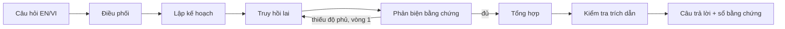

# AtlasTrace — Agentic RAG Song Ngữ

🇬🇧 [Read in English](README.md)

Một hệ thống agentic RAG lấy bằng chứng làm gốc, trả lời câu hỏi bằng **tiếng Việt và tiếng Anh** trên một bộ dữ liệu công khai thật, và cho thấy toàn bộ quá trình: kế hoạch truy hồi, từng lượt bàn giao giữa các tác tử cùng thời gian đo thật, bước kiểm tra độ phủ của tác tử phản biện, và đoạn văn đứng sau mỗi luận điểm. Pipeline tác tử viết bằng **Python (LangGraph + FastAPI)**; giao diện phòng nghiên cứu dùng Next.js.

[](https://github.com/nguyenddung/atlastrace-agentic-rag/actions/workflows/ci.yml)
[](https://www.python.org)
[](https://langchain-ai.github.io/langgraph/)
[](https://fastapi.tiangolo.com)
[](LICENSE)

**[Xem demo](https://atlastrace-ten.vercel.app)** · [Kết quả](#kết-quả) · [Kiến trúc](#kiến-trúc) · [Dữ liệu](#dữ-liệu) · [Chạy ở máy local](#chạy-ở-máy-local)

> Bản demo chạy ở chế độ Demo: không cần API key, không lo hết quota. Hãy hỏi về một trong 48 chủ đề Wikipedia của XQuAD (Super Bowl 50, Nikola Tesla, Oxy, Thành Cát Tư Hãn, rừng Amazon…) bằng tiếng Việt hoặc tiếng Anh.

---

## Vấn đề

RAG một lượt lấy vài đoạn văn rồi viết ra điều nghe hợp lý. Nó hiếm khi kiểm tra bằng chứng có thật sự bao phủ câu hỏi không, có thể trích dẫn đoạn văn chưa từng được truy hồi, và chất lượng giảm âm thầm khi câu hỏi bằng tiếng Việt mà nguồn bằng tiếng Anh.

AtlasTrace làm cho từng lỗi đó hiện ra và đo được:

- **Tác tử phản biện** đo câu hỏi được bằng chứng bao phủ bao nhiêu và kích hoạt một lượt truy hồi bổ sung khi còn thiếu.
- Mọi trích dẫn trong câu trả lời đều được **kiểm tra** với sổ bằng chứng; trích dẫn nằm ngoài sổ bị loại và được đếm.
- Truy hồi **song ngữ nhờ chỉ mục**, nên câu hỏi tiếng Việt được phục vụ tốt ngang câu hỏi tiếng Anh.
- Khi kho tri thức không có câu trả lời, hệ thống **nói rõ điều đó** thay vì đoán.

## Kết quả

Đo bằng `python scripts/evaluate.py` trên toàn bộ **1.190 câu hỏi có nhãn của XQuAD** (báo cáo đầy đủ: [`eval/REPORT.md`](eval/REPORT.md)).

| Truy hồi | Recall@1 | Recall@5 | MRR@10 |
| --- | --- | --- | --- |
| Câu hỏi tiếng Anh → chỉ mục song ngữ | 88,2% | 97,7% | 0,922 |
| Câu hỏi tiếng Việt → chỉ mục song ngữ | 89,2% | 97,0% | 0,925 |
| Câu hỏi tiếng Việt → chỉ mục chỉ tiếng Anh (mốc so sánh) | 28,2% | 47,8% | 0,359 |

| Toàn pipeline (chế độ Demo) | Trích đúng đoạn chuẩn đầu tiên | Đáp án nằm trong câu được trích | Kích hoạt vòng sửa sai | Độ trễ p50 |
| --- | --- | --- | --- | --- |
| Tiếng Anh | 91,3% | 73,0% | 37,6% | ~9 ms |
| Tiếng Việt | 85,8% | 69,1% | 6,9% | ~11 ms |

Chỉ mục song ngữ giúp Recall@5 của câu hỏi tiếng Việt tăng khoảng gấp đôi so với chỉ mục chỉ tiếng Anh. Chỉ số *đáp án nằm trong câu được trích* được đo ở mức câu: đoạn đáp án chuẩn xuất hiện trong câu mà bộ tổng hợp tất định đã chọn.

## Kiến trúc

Một máy trạng thái LangGraph trong `atlastrace/graph.py`. Cả hai chế độ chạy cùng một đồ thị; chỉ phần cài đặt tác tử là khác.



| Nút | Vai trò |
| --- | --- |
| **Điều phối** | Nhận diện ngôn ngữ và ý định của câu hỏi (người, thời gian, số lượng, địa điểm, lý do, dữ kiện) |
| **Lập kế hoạch** | Demo: nguyên câu hỏi, các từ khóa chính và các thực thể. Live: 2–4 truy vấn do mô hình lập |
| **Truy hồi lai** | BM25 + vector băm có trọng số IDF trên 480 tài liệu (240 đoạn × 2 ngôn ngữ), trộn bằng reciprocal rank fusion rồi gộp về mã đoạn văn |
| **Phản biện** | Đo độ phủ từ khóa (có trọng số IDF) của từng đoạn và tổng thể; dưới 75% thì yêu cầu truy hồi bổ sung cho các từ còn thiếu, rồi **chấm lại toàn bộ bằng chứng đã gộp** |
| **Tổng hợp** | Demo: chọn câu khớp nhất theo ngôn ngữ câu hỏi và hiện bản dịch tương ứng theo ngôn ngữ người đọc. Live: câu trả lời của mô hình, được Pydantic kiểm tra |
| **Kiểm tra trích dẫn** | Xóa mọi `[ID]` không có trong sổ bằng chứng và báo số lượng đã xóa |

Chế độ Live suy giảm êm ái: thiếu thông tin xác thực, lỗi cổng hoặc đầu ra sai schema đều được bắt lại, pipeline tất định hoàn tất lượt chạy và giao diện hiện thông báo `fallback` kèm lý do.

**Không có gì viết sẵn:** thời gian từng bước đo bằng `perf_counter`, số vòng phản biện là số vòng đồ thị thực sự chạy, còn kết luận, câu trả lời và độ tin cậy đều tính từ các đoạn văn truy hồi được. Bộ test kiểm tra những tính chất này.

## Dữ liệu

[XQuAD](https://github.com/google-deepmind/xquad) (Google DeepMind): 240 đoạn Wikipedia từ SQuAD v1.1 kèm 1.190 cặp câu hỏi–đáp án, được dịch chuyên nghiệp sang tiếng Việt và căn chỉnh theo từng đoạn. Chuyển đổi vào [`data/xquad/`](data/xquad/README.md) bằng `scripts/fetch_xquad.py`. Giấy phép dữ liệu: CC BY-SA 4.0 (mã nguồn dùng MIT).

## Chạy ở máy local

```bash
git clone https://github.com/nguyenddung/atlastrace-agentic-rag.git
cd atlastrace-agentic-rag

python -m venv .venv && . .venv/bin/activate
pip install -r requirements-dev.txt
npm install

npm run dev:api   # FastAPI ở cổng 8000
npm run dev       # Next.js ở cổng 3000, chuyển tiếp /api/* sang 8000
```

Mở <http://localhost:3000>. **Chế độ Demo không cần biến môi trường nào.** Để dùng Live AI, sao chép `.env.example` thành `.env.local` và đặt `AI_GATEWAY_API_KEY`.

| Lệnh | Tác dụng |
| --- | --- |
| `pytest` | Chạy bộ test Python |
| `python scripts/evaluate.py --write` | Đánh giá đầy đủ, ghi `eval/report.json` và `eval/REPORT.md` |
| `python scripts/build_initial_results.py` | Tính lại kết quả hiển thị trước câu hỏi đầu tiên |
| `npm run verify` | typecheck → lint → build cho giao diện web |

## Triển khai lên Vercel

Ứng dụng Next.js và hàm Python được triển khai cùng nhau. `vercel.json` định tuyến `/api/*` tới `api/index.py` và đóng gói `atlastrace/` cùng `data/xquad/`; Vercel tự cài `requirements.txt`. Để dùng Live AI, bật AI Gateway cho project — bản triển khai xác thực qua OIDC nên không cần lưu khóa.

## Đánh đổi và bước tiếp theo

- **Truy hồi thiên về từ vựng.** BM25 cộng vector băm giúp demo nhẹ và tất định. Mô hình embedding đa ngôn ngữ sẽ giúp với câu hỏi diễn đạt khác, đặt sau cùng giao diện `HybridIndex.search`.
- **Độ phủ chỉ là thước đo gần đúng.** Tín hiệu "không tìm thấy" dựa trên độ phủ từ khóa, bắt được câu hỏi lạc đề rõ ràng nhưng không phải mọi câu hỏi không có đáp án.
- **Câu trả lời demo là trích xuất câu**, chưa phải trích đúng cụm đáp án.
- **Tiếp theo:** một MCP server cung cấp công cụ `search_evidence` để tác tử khác dùng chỉ mục; stream tiến trình tác tử ở chế độ Live.

## Giấy phép

Mã nguồn: [MIT](LICENSE). Dữ liệu trong `data/xquad/`: [CC BY-SA 4.0](https://creativecommons.org/licenses/by-sa/4.0/legalcode).
