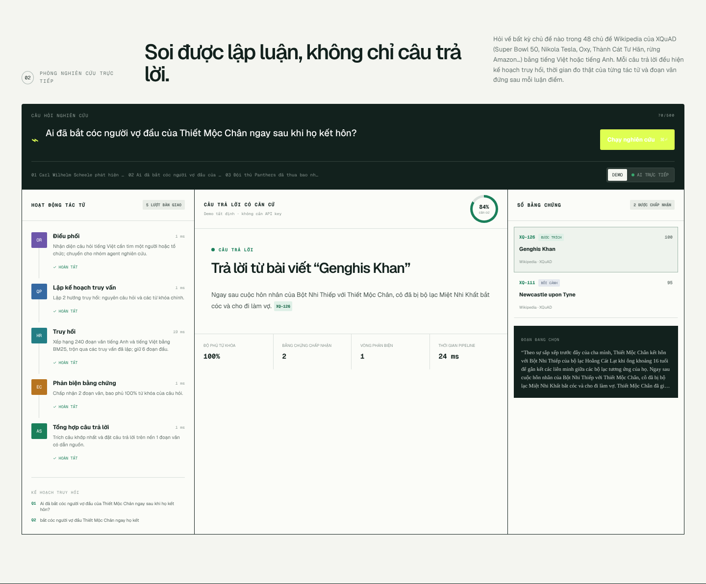
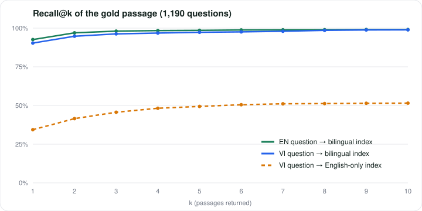
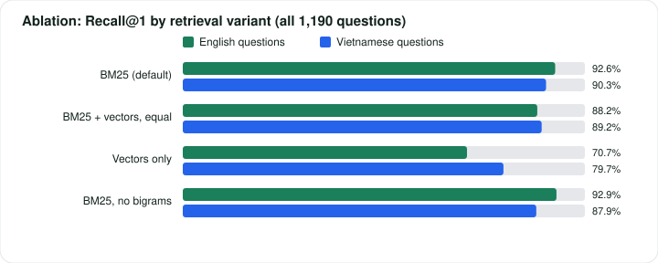
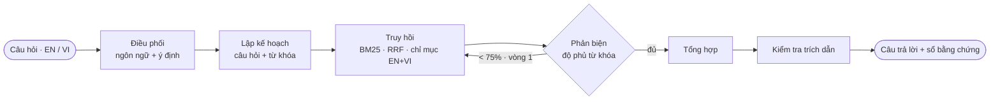

<div align="center">

# AtlasTrace

### Agentic RAG song ngữ, cho thấy toàn bộ quá trình

Hỏi bằng **tiếng Việt hoặc tiếng Anh**. Một nhóm tác tử LangGraph lập kế hoạch, truy hồi, để tác tử phản biện kiểm tra độ phủ, rồi trả lời kèm **trích dẫn đã được kiểm tra** — trên một bộ dữ liệu công khai thật, mọi con số đều đo được.

[](https://github.com/nguyenddung/atlastrace-agentic-rag/actions/workflows/ci.yml)


[](LICENSE)

**[Xem demo](https://atlastrace-ten.vercel.app)** · [Kết quả](#ket-qua) · [Đánh giá](#danh-gia) · [Kiến trúc](#kien-truc) · [Chạy ở máy local](#chay-local) · 🇬🇧 [English](README.md)

<br>



</div>

---

## ✨ Điểm nổi bật

| | |
| --- | --- |
| 🌏 **Song ngữ nhờ chỉ mục** | Mỗi đoạn văn được lập chỉ mục bằng cả tiếng Anh và tiếng Việt. Câu hỏi tiếng Việt khớp thẳng với văn bản tiếng Việt: **Recall@5 97,3%**, so với **49,4%** nếu chỉ có chỉ mục tiếng Anh. |
| 🔁 **Có tác tử phản biện** | Tác tử phản biện đo câu hỏi được bằng chứng bao phủ bao nhiêu, có thể yêu cầu một lượt truy hồi bổ sung, rồi chấm lại toàn bộ bằng chứng đã gộp. |
| 🔒 **Trích dẫn được kiểm tra** | Mọi `[ID]` trong câu trả lời không nằm trong sổ bằng chứng đều bị loại và được đếm. |
| 🙅 **Biết nói "không tìm thấy"** | Khi không đoạn nào bao phủ câu hỏi, hệ thống nói rõ và chỉ ra đoạn gần nhất thay vì đoán. |
| 📏 **Đo thật, không viết sẵn** | Thời gian từng tác tử được đo, số vòng phản biện là số vòng thực chạy, và các con số trong README lấy từ `scripts/evaluate.py` trên 1.190 câu hỏi có nhãn. |
| 🛟 **Chạy được không cần key** | Chế độ Demo hoàn toàn tất định. Chế độ Live dùng mô hình qua Vercel AI Gateway và tự quay về Demo khi có lỗi. |

---

<a id="ket-qua"></a>

## 📊 Kết quả

Trên toàn bộ **1.190 câu hỏi có nhãn của XQuAD**, tách theo ngôn ngữ.

<table>
<tr>
<td width="50%" valign="top">

**Truy hồi** (đoạn văn chuẩn)

| | Recall@1 | Recall@5 | MRR@10 |
| --- | --- | --- | --- |
| 🇬🇧 EN → chỉ mục song ngữ | **92,6%** | **98,6%** | 0,953 |
| 🇻🇳 VI → chỉ mục song ngữ | **90,3%** | **97,3%** | 0,935 |
| 🇻🇳 VI → chỉ mục chỉ tiếng Anh | 34,4% | 49,4% | 0,405 |

</td>
<td width="50%" valign="top">

**Toàn pipeline** (chế độ Demo)

| | 🇬🇧 EN | 🇻🇳 VI |
| --- | --- | --- |
| Trích đúng đoạn chuẩn đầu tiên | **92,5%** | **90,3%** |
| Đoạn chuẩn có trong sổ bằng chứng | 96,7% | 96,4% |
| Đáp án nằm trong câu được trích | 73,9% | 72,9% |
| Độ trễ p50 | ~7 ms | ~9 ms |

</td>
</tr>
</table>

<p align="center">
  
</p>

---

<a id="danh-gia"></a>

## 🧪 Đánh giá

`python scripts/evaluate.py --write` chạy mọi câu hỏi có nhãn qua chỉ mục và qua toàn pipeline, rồi ghi [`eval/REPORT.md`](eval/REPORT.md), [`eval/report.json`](eval/report.json) và các biểu đồ. Pipeline Demo là tất định nên kết quả lặp lại chính xác (trừ độ trễ). CI chạy bản rút gọn 200 câu ở mỗi lần push.

### Đo những gì

| Chỉ số | Định nghĩa |
| --- | --- |
| **Recall@k / MRR@10** | Đoạn chuẩn có nằm trong top *k* của chỉ mục với câu hỏi gốc không; trung bình 1/thứ hạng |
| **Trích đúng đoạn chuẩn đầu tiên** | Sau lập kế hoạch → truy hồi → phản biện, đoạn chuẩn đứng đầu sổ bằng chứng |
| **Đáp án nằm trong câu được trích** | Đoạn đáp án chuẩn xuất hiện trong câu mà bộ tổng hợp chọn (đo ở mức câu, không phải khớp chính xác cụm từ) |
| **Tỷ lệ vòng sửa sai** | Tỷ lệ câu hỏi mà tác tử phản biện yêu cầu truy hồi lần hai |
| **Tỷ lệ "không tìm thấy"** | Mọi câu hỏi XQuAD đều có đáp án, nên đây là tỷ lệ báo nhầm (EN 3,1%, VI 0,1%) |

### Ablation: mỗi thành phần đóng góp bao nhiêu

<p align="center">
  
</p>

| Biến thể | 🇬🇧 Recall@1 | 🇻🇳 Recall@1 |
| --- | --- | --- |
| **BM25, trộn RRF qua các truy vấn** (mặc định) | **92,6%** | **90,3%** |
| BM25 + vector băm, trọng số RRF bằng nhau | 88,2% | 89,2% |
| Chỉ vector băm | 70,7% | 79,7% |
| Mặc định nhưng bỏ bigram âm tiết | 92,9% | 87,9% |

**Ba phát hiện định hình thiết kế**

1. **Thành phần vector được đặt trọng số 0.** Trọng số trộn được chọn trên tập dev (24 bài viết đầu) và kiểm tra trên 24 bài còn lại: trọng số 0 cho Recall@1 **91,0% EN / 88,2% VI** trên nửa giữ lại, so với 87,5% / 87,5% khi trọng số bằng nhau. Vector băm chỉ là túi từ đã băm nên không có thông tin gì BM25 thiếu mà còn thêm va chạm băm. Vị trí này để dành cho embedding đa ngôn ngữ thật.
2. **Bigram âm tiết chỉ có ích cho tiếng Việt.** Chúng tăng 2,4 điểm Recall@1 cho tiếng Việt (từ nhiều âm tiết như *đội thủ*, *bắt cóc*) và gần như không ảnh hưởng tiếng Anh.
3. **Truy vấn "thực thể" đã bị bỏ khỏi bộ lập kế hoạch.** Khi được tính ngang các truy vấn khác trong RRF, nó đè nặng các từ viết hoa và kéo Recall@1 toàn pipeline tiếng Việt từ 90% xuống 80%.

### Giới hạn

- **Vòng sửa sai hiếm khi đổi câu trả lời trên XQuAD.** Ở 417 câu EN / 58 câu VI có kích hoạt vòng này, đoạn được trích không đổi: đoạn chuẩn gần như luôn nằm sẵn trong 6 đoạn đầu, và độ phủ thấp chủ yếu do diễn đạt khác. Vòng này chỉ tốn vài mili giây và dành cho kho dữ liệu mà bằng chứng nằm rải rác, cùng chế độ Live nơi mô hình tự quyết định còn thiếu gì.
- **Phần lớn lỗi là đoạn liền kề** trong cùng bài viết (xem phân tích lỗi trong báo cáo). Bước tiếp theo là reranker dạng cross-encoder.
- **Câu trả lời Demo là trích một câu.** Chế độ Live viết câu trả lời đầy đủ.

---

<a id="kien-truc"></a>

## 🏗️ Kiến trúc



Toàn bộ pipeline là một `StateGraph` của LangGraph trong [`atlastrace/graph.py`](atlastrace/graph.py). Demo và Live chạy cùng một đồ thị, chỉ khác phần cài đặt tác tử.

| Nút | Chế độ Demo (tất định) | Chế độ Live (AI Gateway) |
| --- | --- | --- |
| **Điều phối** | Nhận diện ngôn ngữ và ý định (ai / khi nào / bao nhiêu / ở đâu / tại sao / dữ kiện) | như Demo |
| **Lập kế hoạch** | Nguyên câu hỏi cộng các từ khóa chính | 2–4 truy vấn do mô hình lập |
| **Truy hồi** | BM25 trên 480 tài liệu (240 đoạn × 2 ngôn ngữ), RRF qua các truy vấn, gộp về mã đoạn văn | như Demo |
| **Phản biện** | Đo độ phủ từ khóa có trọng số IDF; dưới 75% thì yêu cầu truy hồi bổ sung | Mô hình chỉ ra góc nhìn còn thiếu |
| **Tổng hợp** | Câu khớp nhất theo ngôn ngữ câu hỏi, hiển thị bằng ngôn ngữ người đọc nhờ căn chỉnh câu | Câu trả lời của mô hình, được Pydantic kiểm tra |
| **Kiểm tra trích dẫn** | Loại trích dẫn nằm ngoài sổ bằng chứng và đếm số lượng | như Demo |

---

## 📚 Dữ liệu

[**XQuAD**](https://github.com/google-deepmind/xquad) (Google DeepMind): 240 đoạn Wikipedia từ SQuAD v1.1 kèm 1.190 cặp câu hỏi–đáp án, được dịch chuyên nghiệp sang tiếng Việt và căn chỉnh theo từng đoạn, thuộc 48 chủ đề. `scripts/fetch_xquad.py` tải và chuyển đổi vào [`data/xquad/`](data/xquad/README.md). Giấy phép dữ liệu: CC BY-SA 4.0.

---

<a id="chay-local"></a>

## 🚀 Chạy ở máy local

```bash
git clone https://github.com/nguyenddung/atlastrace-agentic-rag.git
cd atlastrace-agentic-rag

python -m venv .venv && . .venv/bin/activate
pip install -r requirements-dev.txt
npm install

npm run dev:api   # FastAPI ở cổng 8000
npm run dev       # Next.js ở cổng 3000, chuyển tiếp /api/* sang 8000
```

Mở <http://localhost:3000>. **Chế độ Demo không cần biến môi trường nào.** Để dùng Live AI, sao chép `.env.example` thành `.env.local` và đặt `AI_GATEWAY_API_KEY`.

| Lệnh | Tác dụng |
| --- | --- |
| `pytest` | 20 test: chất lượng truy hồi, kiểm tra trích dẫn, vòng sửa sai, fallback, chạy Live giả lập, API |
| `python scripts/evaluate.py --write` | Đánh giá đầy đủ → `eval/REPORT.md`, `eval/report.json`, biểu đồ |
| `python scripts/build_initial_results.py` | Tính lại kết quả hiển thị trước câu hỏi đầu tiên |
| `npm run verify` | Kiểm tra kiểu → lint → build giao diện web |

## ☁️ Triển khai lên Vercel

Ứng dụng Next.js và hàm Python được triển khai cùng nhau: `vercel.json` định tuyến `/api/*` tới `api/index.py` và đóng gói `atlastrace/` cùng `data/xquad/`; Vercel tự cài `requirements.txt`. Để dùng Live AI, bật AI Gateway cho project — bản triển khai xác thực qua OIDC nên không cần lưu khóa.

## 🛣️ Bước tiếp theo

- Embedding đa ngôn ngữ cho vị trí vector, tinh chỉnh lại trên tập dev
- Reranker dạng cross-encoder cho các lỗi đoạn liền kề
- MCP server cung cấp công cụ `search_evidence` để tác tử khác dùng chỉ mục
- Stream tiến trình tác tử ở chế độ Live

## Giấy phép

Mã nguồn: [MIT](LICENSE) · Dữ liệu trong `data/xquad/`: [CC BY-SA 4.0](https://creativecommons.org/licenses/by-sa/4.0/legalcode)
