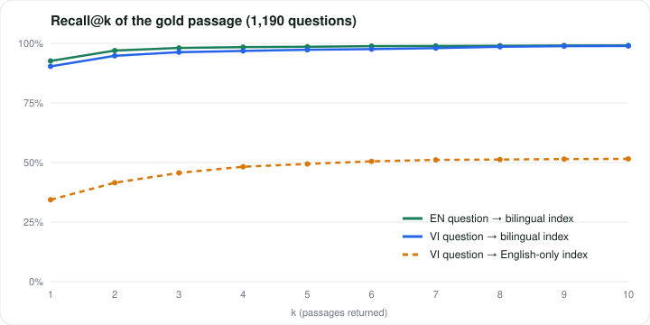
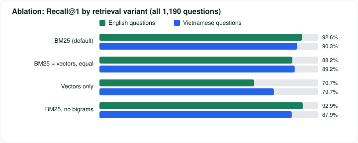

# AtlasTrace evaluation report

Dataset: XQuAD (EN + VI), 1,190 labelled questions over 240 passages. Generated by `python scripts/evaluate.py --write`; every number below is reproducible because the Demo pipeline is deterministic.

## 1. Retrieval

| Setting | Recall@1 | Recall@5 | Recall@10 | MRR@10 |
| --- | --- | --- | --- | --- |
| English question → bilingual index | 92.6% | 98.6% | 99.1% | 0.953 |
| Vietnamese question → bilingual index | 90.3% | 97.3% | 98.9% | 0.935 |
| Vietnamese question → English-only index (baseline) | 34.4% | 49.4% | 51.5% | 0.405 |

## 2. Ablations

| Variant | EN Recall@1 | EN MRR@10 | VI Recall@1 | VI MRR@10 |
| --- | --- | --- | --- | --- |
| BM25 with RRF over queries (default, vector weight 0) | 92.6% | 0.953 | 90.3% | 0.935 |
| BM25 + hashed vectors, equal RRF weight | 88.2% | 0.922 | 89.2% | 0.925 |
| Hashed vectors only | 70.7% | 0.770 | 79.7% | 0.851 |
| Default without syllable bigrams | 92.9% | 0.955 | 87.9% | 0.919 |

### Choosing the fusion weight (dev split: first 24 articles, 632 questions)

| Vector weight in RRF | EN Recall@1 | VI Recall@1 |
| --- | --- | --- |
| 0.0 | 94.0% | 92.2% |
| 0.1 | 93.0% | 92.2% |
| 0.25 | 91.9% | 91.9% |
| 0.5 | 89.7% | 91.8% |
| 1.0 | 88.8% | 90.8% |

On the held-out half (last 24 articles, 558 questions) the chosen weight 0 gives Recall@1 91.0% EN / 88.2% VI, versus 87.5% / 87.5% with equal weights.

The hashed vectors are a bag of hashed terms, so they carry no information BM25 lacks and add hash collisions. XQuAD questions also share many words with their passage. Learned multilingual embeddings are the component that would earn a non-zero weight; the interface is ready for them.

## 3. End-to-end pipeline (Demo mode)

| Language | Gold passage cited first | Gold passage in ledger | Answer in extracted sentence | Corrective loop | Flagged not found | p50 | p95 |
| --- | --- | --- | --- | --- | --- | --- | --- |
| English | 92.5% | 96.7% | 73.9% | 35.0% | 3.1% | 6.8 ms | 13.6 ms |
| Vietnamese | 90.3% | 96.4% | 72.9% | 4.9% | 0.1% | 8.9 ms | 13.3 ms |

## 4. What the corrective loop changed

Measured only on the questions where the critic asked for a second retrieval.

| Language | Questions | Gold in ledger: before → after | Gold cited first: before → after |
| --- | --- | --- | --- |
| English | 417 | 93.8% → 93.8% | 89.9% → 89.9% |
| Vietnamese | 58 | 89.7% → 89.7% | 75.9% → 75.9% |

On XQuAD the second retrieval never changes which passage is cited: when the gold passage is retrieved at all, it is already in the first six. Low term coverage here mostly reflects paraphrase, not missing evidence. The loop is kept because it costs a few milliseconds and matters on corpora where evidence is spread across documents, and in Live mode, where the model critic decides what is missing.

## 5. By question type

| Intent | EN n | EN cited first | EN answer hit | VI n | VI cited first | VI answer hit |
| --- | --- | --- | --- | --- | --- | --- |
| person | 146 | 95.2% | 69.2% | 138 | 92.0% | 66.7% |
| time | 131 | 90.1% | 77.1% | 117 | 89.7% | 76.1% |
| quantity | 105 | 95.2% | 83.8% | 156 | 92.9% | 73.7% |
| place | 45 | 93.3% | 77.8% | 32 | 96.9% | 68.8% |
| reason | 15 | 100.0% | 60.0% | 15 | 100.0% | 60.0% |
| fact | 748 | 91.8% | 73.0% | 732 | 89.1% | 73.8% |

Intent is detected from the question words in each language, so EN and VI counts differ slightly.

## 6. Error analysis

Sampled misses where another passage was cited first (Vietnamese questions):

| Question | Gold passage | Cited first | Gold still in ledger |
| --- | --- | --- | --- |
| Ai là người nhận bóng để chuyển đổi 2 điểm thành công? | XQ-005 (Super Bowl 50) | XQ-002 (Super Bowl 50) | yes |
| Công ty nào được giao nhiệm vụ cố gắng khôi phục các băng gốc? | XQ-075 (Apollo program) | XQ-018 (Nikola Tesla) | yes |
| Người Ấn Độ nổi tiếng nào đã thực hành bất tuân dân sự? | XQ-141 (Civil disobedience) | XQ-142 (Civil disobedience) | no |
| Doctor Who đi du lịch một mình bao lâu một lần? | XQ-171 (Doctor Who) | XQ-173 (Doctor Who) | yes |

Most misses are neighbouring paragraphs of the same article, where the question's terms appear in several passages. That is a ranking problem a cross-encoder reranker or multilingual embeddings would address.

## Metric definitions

- **Recall@k**: the gold passage is among the top k results of the index for the raw question.
- **MRR@10**: mean of 1/rank of the gold passage, 0 if it is not in the top 10.
- **Gold passage cited first**: the full pipeline (plan → retrieve → critique → synthesize) puts the gold passage first in the evidence ledger.
- **Answer in extracted sentence**: the gold answer span appears in the sentence the deterministic synthesizer picked. Sentence-level, not exact-match span extraction.
- **Corrective loop**: the critic measured under 75% term coverage and triggered a second retrieval.
- **Flagged not found**: the critic judged no passage to cover enough of the question to answer it. On XQuAD every question is answerable, so this is a false-negative rate.
